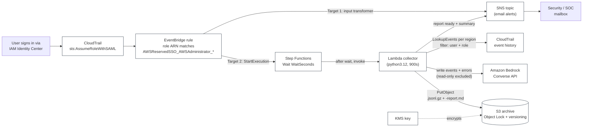
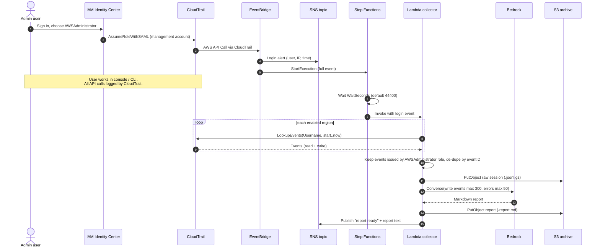
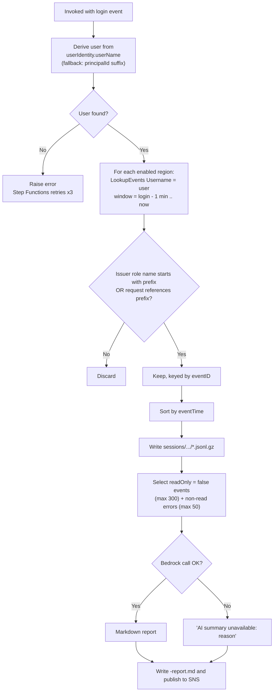
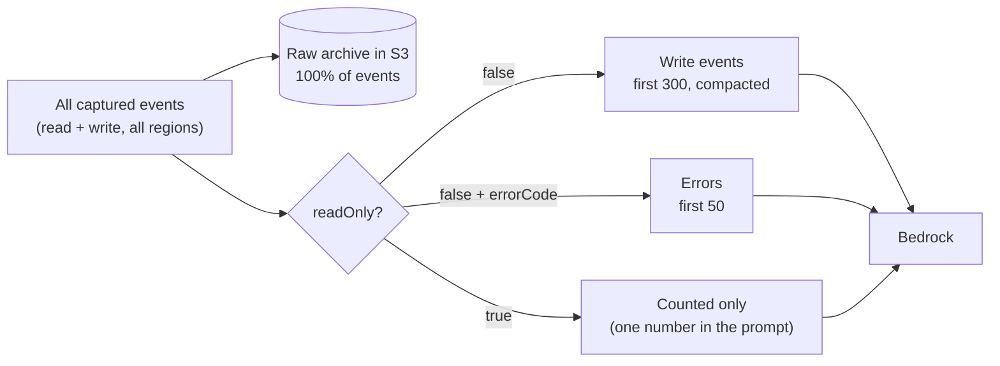

# SSO Admin Session Capture

Automatically records everything a user does during an **AWSAdministrator** IAM Identity Center (SSO) session in the AWS Organizations **management account**, archives it immutably, and produces an AI-written, plain-English summary of the session.

- **Template:** `sso-admin-session-capture.yaml` (CloudFormation, single stack)
- **Deploy to:** management account, `ca-central-1`
- **Trigger:** SSO login using a role named `AWSReservedSSO_AWSAdministrator_*`
- **Outputs:** SNS login alert, raw session log (`.jsonl.gz`), AI summary report (`-report.md`) in S3, report emailed via SNS

---

## 1. How it works

1. A user signs in through IAM Identity Center and assumes the AWSAdministrator permission set. CloudTrail records `sts:AssumeRoleWithSAML` for the role `AWSReservedSSO_AWSAdministrator_<hash>`.
2. An EventBridge rule matches that event and does two things: sends an immediate **login alert** to SNS, and starts a **Step Functions** execution.
3. The state machine **waits** (default 12h20m: maximum SSO session length plus CloudTrail delivery lag) so the session has finished before collecting.
4. A **Lambda collector** queries CloudTrail `LookupEvents` for that user across every enabled region, keeps only events issued by the AWSAdministrator role, and de-duplicates by event ID.
5. The collector writes the raw events to an **Object Lock / KMS-encrypted S3 bucket**.
6. It sends only the **state-changing (non read-only) events** and their errors to **Amazon Bedrock**, which writes a Markdown summary and risk assessment. The report is stored next to the raw log and published to SNS.

### Architecture



### Sequence of a single session



### Decision logic inside the collector



---

## 2. Resources created

| Resource | Purpose |
|---|---|
| `AWS::Events::Rule` (LoginRule) | Detects AWSAdministrator SSO logins (`wildcard` match on role ARN) |
| `AWS::SNS::Topic` + policy | Login alerts, report-ready messages; optional email subscription |
| `AWS::StepFunctions::StateMachine` (Standard) | Waits for the session window, invokes the collector with retries (3x, exponential backoff) |
| `AWS::Lambda::Function` (python3.12, 512 MB, 900 s) | Collects events, builds the archive, calls Bedrock |
| `AWS::S3::Bucket` | Archive: Object Lock, versioning, SSE-KMS, public access blocked, TLS-only, `DeletionPolicy: Retain` |
| `AWS::KMS::Key` | Encrypts archived objects (rotation enabled) |
| IAM roles (3) | Collector, state machine, rule-to-state-machine |

### IAM permissions of the collector

| Permission | Scope |
|---|---|
| `cloudtrail:LookupEvents`, `ec2:DescribeRegions` | `*` (APIs do not support resource scoping) |
| `s3:PutObject` | `<bucket>/sessions/*` only (no read, no delete) |
| `kms:GenerateDataKey`, `kms:Decrypt` | The archive key |
| `sns:Publish` | The alert topic |
| `bedrock:InvokeModel` | `*` (model/profile ARNs vary by region and profile) |

---

## 3. Parameters

| Parameter | Default | Description |
|---|---|---|
| `SSORoleNamePrefix` | `AWSReservedSSO_AWSAdministrator_` | Prefix of the SSO-provisioned role. Change if the permission set name differs |
| `AlertEmail` | *(blank)* | Email for alerts and reports. Blank = no subscription |
| `WaitSeconds` | `44400` | Delay before collection (12h + 20 min). Lower it if your SSO session duration is shorter |
| `BedrockModelId` | `ca.anthropic.claude-sonnet-4-5-20250929-v1:0` | Model or inference profile. **Verify it exists in ca-central-1** |
| `BedrockRegion` | `ca-central-1` | Region used for the Bedrock call |
| `RetentionDays` | `365` | Object Lock default retention |
| `ObjectLockMode` | `GOVERNANCE` | `GOVERNANCE` (privileged override possible) or `COMPLIANCE` (nobody can shorten or delete, including root) |

---

## 4. Prerequisites

1. Run in the **management account**, in **ca-central-1**.
2. IAM Identity Center is enabled and the AWSAdministrator permission set is assigned to the management account (this creates the `AWSReservedSSO_AWSAdministrator_*` role).
3. CloudTrail is already logging management events in this account (existing org trail). This stack does not create a trail.
4. Bedrock **model access** is enabled for the model in `BedrockRegion`, and the model/profile ID is valid there (Bedrock console > Inference profiles / Model access).
5. Permissions to create IAM roles, KMS keys, S3 buckets, Lambda, Step Functions, EventBridge and SNS.

---

## 5. Deployment

```bash
aws cloudformation deploy \
  --region ca-central-1 \
  --template-file sso-admin-session-capture.yaml \
  --stack-name sso-admin-session-capture \
  --capabilities CAPABILITY_IAM \
  --parameter-overrides \
      AlertEmail=security@example.com \
      ObjectLockMode=GOVERNANCE \
      RetentionDays=365
```

Then:

1. **Confirm the SNS subscription** email (AWS sends a confirmation link).
2. Note the stack outputs: `ArchiveBucketName`, `AlertTopicArn`, `StateMachineArn`.

---

## 6. Testing

1. Sign in via the Identity Center portal with the AWSAdministrator role and do a few things: one **write** action (for example, create and delete a tag on a test resource) and a few reads.
2. Within minutes you should receive the **login alert** email, and a new execution should appear in Step Functions in state *Running* (waiting).
3. To avoid waiting 12 hours during testing, either:
   - deploy a test stack with `WaitSeconds=1200` (20 minutes, allowing for CloudTrail lag), or
   - invoke the Lambda manually with a copy of the login event from the state machine execution input.
4. Check S3 for `sessions/<user>/<yyyy>/<mm>/<dd>/<HHMMSS>-<eventId>.jsonl.gz` and `...-report.md`, and your inbox for the "SSO admin session report ready" message.

> **Verify the trigger first.** Confirm that the login produces an `AssumeRoleWithSAML` event in **ca-central-1** CloudTrail (CloudTrail > Event history, filter by event name). If it appears in another region, or CLI logins do not produce it, adjust the rule pattern or deploy the stack where the event is logged.

---

## 7. Output format

### S3 layout

```text
s3://<ArchiveBucketName>/
  sessions/
    jane.doe@example.com/
      2026/11/13/
        143015-<loginEventId>.jsonl.gz       # raw CloudTrail events, one JSON per line, sorted by time
        143015-<loginEventId>-report.md      # AI-generated summary
```

### AI report sections

1. **Overview**: who, when, duration, event totals
2. **What they did**: state-changing actions grouped by service, in plain English
3. **Security-sensitive actions**: IAM, Organizations, SCPs, CloudTrail, KMS, Identity Center, billing
4. **Failed or denied attempts**
5. **Risk assessment**: low / medium / high with reasons

### Reading the raw log

```bash
aws s3 cp s3://<bucket>/sessions/<user>/2026/11/13/143015-<id>.jsonl.gz - \
  | gunzip \
  | jq -r '[.eventTime, .eventSource, .eventName, .awsRegion, (.errorCode // "-")] | @tsv'
```

---

## 8. What is and is not analyzed by AI



- Each event is compacted to time, service, action, region, source IP, error code and the first 250 characters of the request parameters.
- If a session has more than 300 write events, only the **first 300** are summarized. The raw archive remains complete, so review it for very large sessions.
- The prompt tells the model that log content is **untrusted data** and must not be followed as instructions (log fields such as tag values or names are user-controlled).

---

## 9. Security considerations

| Topic | Detail |
|---|---|
| **SCPs do not apply to the management account** | An AWSAdministrator user could modify or delete this stack, the rule, or the Lambda. Object Lock protects archived objects, not the pipeline. |
| **Recommended hardening** | Replicate the bucket to a **log-archive account** (S3 replication with Object Lock); alert on changes to this stack, the EventBridge rule and state machine (a second rule on CloudFormation/Events/Lambda API calls targeting a separate-account bus); keep the org trail in the log-archive account as the source of truth. |
| **COMPLIANCE vs GOVERNANCE** | GOVERNANCE lets principals with `s3:BypassGovernanceRetention` delete early. COMPLIANCE cannot be shortened by anyone, so choose it deliberately. |
| **Bucket cannot be deleted easily** | `DeletionPolicy: Retain` plus Object Lock means the bucket and objects persist after stack deletion until retention ends. |
| **Sensitive content** | Request parameters sent to Bedrock may contain resource names or identifiers. Bedrock does not use inputs to train models, but confirm the chosen model and region meet your data-residency policy. |
| **AI reports are advisory** | Treat them as a reading aid. The raw log is the evidence. |

---

## 10. Limitations

| Limitation | Impact / workaround |
|---|---|
| `LookupEvents` covers **management events only**, last 90 days | S3/Lambda data events are not captured. Query the org trail with Athena or CloudTrail Lake for those. |
| `LookupEvents` quota is ~2 requests/second per region | Adaptive retries are enabled. Very busy sessions take longer (Lambda max 15 minutes). |
| CloudTrail delivery lag (typically 5 to 15 minutes) | The 20-minute buffer in `WaitSeconds` covers it. Events after the wait window are not captured. |
| Report delayed until the wait elapses | Lower `WaitSeconds` if sessions are shorter. |
| Overlapping sessions by the same user | Reports may include some of each other's events (matching is by user and role, not by session). |
| Only enabled regions are queried | `ec2:DescribeRegions` returns enabled regions. Opt-in regions you have not enabled are not queried. |
| Trigger is `AssumeRoleWithSAML` | Confirm it fires for your login paths (console and CLI). |
| Inline Lambda code is limited to 4096 characters | If you extend the code, move it to an S3-hosted package. |

---

## 11. Troubleshooting

| Symptom | Likely cause and fix |
|---|---|
| No alert on login | Event is logged in a different region, or the role prefix differs. Check CloudTrail event history for `AssumeRoleWithSAML` and its `requestParameters.roleArn`. Adjust `SSORoleNamePrefix` or deploy in the right region. |
| Alert received but no report | Check the Step Functions execution (still in Wait state is normal until `WaitSeconds` elapses). If failed, check Lambda CloudWatch logs. |
| Report says "AI summary unavailable" | Bedrock model access not enabled, wrong `BedrockModelId` for `ca-central-1`, or throttling. The raw archive is still written. |
| Lambda timeout | Very large sessions or heavy throttling. Reduce regions queried or move to a longer-running collector (ECS/Fargate). |
| `AccessDenied` on S3 write | Check the KMS key policy and bucket policy were not modified. |
| Duplicate reports | Two executions for one login (for example, repeated `AssumeRoleWithSAML` calls). Acceptable, or add de-duplication on user and time. |

---

## 12. Cost drivers

- **Bedrock**: one Converse call per session. Cost scales with prompt size (capped at roughly 350 events) and output (max 3,000 tokens).
- **Step Functions Standard**: a few state transitions per session. The Wait state itself is free.
- **Lambda**: one invocation of a few minutes per session.
- **S3 + KMS**: small compressed objects, retained for `RetentionDays`.
- **SNS, EventBridge**: negligible.

---

## 13. Cleanup

```bash
aws cloudformation delete-stack --region ca-central-1 --stack-name sso-admin-session-capture
```

The S3 bucket and KMS key are retained or protected by Object Lock until the retention period ends. Remove the bucket manually afterwards if desired. In COMPLIANCE mode, objects cannot be deleted before retention expires.
